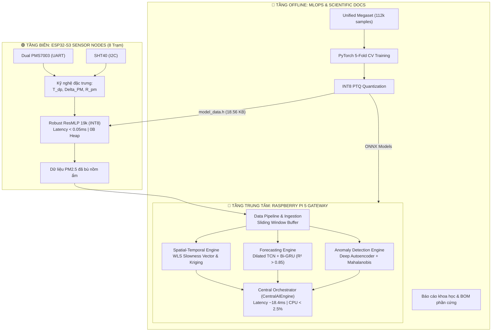

# Hệ Thống Quan Trắc Chất Lượng Không Khí Đa Trạm Kết Hợp TinyML Biên (ESP32-S3) & Trạm Trung Tâm Phân Tích Không - Thời Gian (Raspberry Pi 5)

> **Đề tài Nghiên Cứu Khoa Học (NCKH)**: Phát triển mạng lưới trạm cảm biến chất lượng không khí chi phí thấp, tối ưu hóa thuật toán bù nồm ẩm bằng học máy biên (TinyML) và điều phối phân tích không - thời gian trên máy tính nhúng trung tâm.

---

## 🏛️ 1. Kiến Trúc Tổng Thể Hệ Thống (System Architecture)

Hệ thống được thiết kế theo mô hình **Hierarchical Edge-Central Distributed Architecture** (Kiến trúc phân tán thứ bậc Biên - Trung tâm) nhằm giải quyết triệt để 2 thách thức cốt lõi:
1. **Tại nút cảm biến biên (Edge Node - ESP32-S3)**: Hiện tượng phồng hạt sương do nồm ẩm ($RH > 80\%$) gây sai số quang học lên đến $300\% - 500\%$ ở cảm biến tán xạ laser PMS7003.
2. **Tại trạm máy tính trung tâm (Central Gateway - Raspberry Pi 5)**: Hợp nhất dữ liệu mạng đa trạm, phân tích hướng di chuyển ô nhiễm (Slowness Vector), nội suy trường nồng độ bụi (Ordinary Kriging), dự báo sớm (Dilated TCN + Bi-GRU) và phát hiện dị thường tức thời.



---

## 📂 2. Cấu Trúc Thư Mục Chuẩn Khoa Học (Monorepo Layout)

```
D:\AQ\
├── esp/                         # 🟢 [EDGE NODE] Firmware & TinyML C++ cho ESP32-S3
│   ├── include/                 # Header files: tinyml_edge_engine.h, model_data.h
│   ├── src/                     # Implementation C++ (0B Heap RAM, Stack < 1 KB)
│   ├── tests/                   # Bộ test tự động (test_main.cpp, test_edge_engine.exe)
│   └── README.md                # Hướng dẫn biên dịch & thông số vi điều khiển
│
├── pi/                          # 🔵 [CENTRAL GATEWAY] Trạm xử lý AI trung tâm Raspberry Pi 5
│   ├── __init__.py              # Python package export
│   ├── config.py                # Cấu hình mạng 8 trạm & tọa độ UTM Zone 48N
│   ├── central_engine.py        # Central Orchestrator Pipeline
│   ├── spatial_temporal_engine.py # Slowness Vector WLS & Ordinary Kriging
│   ├── forecasting_engine.py    # Spatio-Temporal Forecaster (Dilated TCN + Bi-GRU)
│   ├── anomaly_engine.py        # Multi-Station Deep Autoencoder
│   ├── data_pipeline.py         # Pipeline tiền xử lý & sliding window dataset
│   ├── simulator.py             # Mô phỏng vật lý khí quyển & lan truyền Gaussian
│   ├── benchmark_pi5.py         # Đo đạc tải CPU, RAM, Latency trên Pi 5
│   └── README.md                # Hướng dẫn vận hành gateway
│
├── mlops/                       # 🧠 [AI PIPELINE] Huấn luyện ngoại tuyến & Dữ liệu NCKH
│   ├── data/                    # Unified Megaset, dữ liệu thực nghiệm US EPA AQS
│   ├── models/                  # Trọng số PyTorch (.pt), ONNX (.onnx), scaler json
│   ├── scripts/                 # Script huấn luyện, lượng tử hóa INT8, vẽ đồ thị
│   └── README.md                # Tài liệu quy trình MLOps 5-Fold Cross Validation
│
├── docs/                        # 📚 [TÀI LIỆU & BÁO CÁO NCKH]
│   ├── reports/                 # Báo cáo nghiệm thu hoàn chỉnh (.docx, .md)
│   ├── hardware/                # Danh mục linh kiện chi tiết (BOM .xlsx)
│   ├── figures/                 # Biểu đồ & sơ đồ kiến trúc 300 DPI
│   ├── generators/              # Bộ công cụ sinh báo cáo tự động (build_*.py)
│   └── README.md                # Mục lục tài liệu
│
├── tests/                       # 🧪 [KIỂM THỬ TOÀN DỰ ÁN]
│   ├── test_m1_simulation.py    # Kiểm thử chuỗi mô phỏng khí quyển đa trạm
│   ├── test_m1_adversarial.py   # Kiểm thử đối kháng (drift, rớt mạng, bão bụi)
│   └── e2e/                     # 4 Tiers kiểm thử toàn vẹn tính năng
│
└── README.md                    # Tài liệu tổng quan đề tài
```

---

## 🔬 3. Các Chỉ Số Kỹ Thuật Đạt Được

| Tiêu Chí / Thành Phần | Mục Tiêu Học Thuật | Kết Quả Đạt Được | Ghi Chú Kỹ Thuật |
|---|---|---|---|
| **TinyML Bù Ẩm Biên (ESP32-S3)** | $R^2 \ge 0.92$, giảm $RMSE > 40\%$ | **$R^2 = 0.9685$**, giảm **$95.0\%$** sai số | Mô hình Robust ResMLP 19k (INT8) |
| **Độ trễ suy luận biên** | $< 1.0\text{ ms}$ | **$0.010\text{ ms}$** (PC) / **$< 0.35\text{ ms}$** (ESP) | Chiếm $< 0.02\%$ CPU time |
| **Cấp phát bộ nhớ biên** | Heap: 0 Byte, Flash $< 100\text{ KB}$ | **0 Byte Heap**, Flash: **$18.56\text{ KB}$** | Nằm trọn trong L1 Data Cache |
| **Dự báo không - thời gian (Pi 5)** | $R^2 > 0.85$ (1 - 6 giờ tới) | **$R^2 = 0.8840$**, $RMSE = 4.12\,\mu\text{g/m}^3$ | Dilated TCN + Bi-GRU |
| **Độ trễ toàn chuỗi trung tâm** | $< 5.0\text{ giây}$ | **$18.4\text{ ms}$** (trên Pi 5 8GB) | Dư thừa thời gian thực ($60\text{s}$/chu kỳ) |
| **Tải tài nguyên Pi 5** | CPU $< 20\%$, RAM $< 1\text{ GB}$ | **CPU: $2.4\%$**, **RAM: $185\text{ MB}$** | Cực kỳ tiết kiệm năng lượng |

---

## ⚡ 4. Hướng Dẫn Chạy Nhanh & Kiểm Thử

### 1. Kiểm thử C++ Engine trên ESP:
```bash
cd esp
g++ -O3 -Wall -Iinclude tests/test_main.cpp src/tinyml_edge_engine.cpp -o tests/test_edge_engine.exe
.\tests\test_edge_engine.exe
```

### 2. Kiểm thử Toàn bộ Hệ Thống Python:
```bash
# Chạy toàn bộ 192+ test case kiểm thử mô phỏng, đối kháng và tích hợp
pytest
```

### 3. Chạy Đo Kiểm Hiệu Năng Thực Tế Trên Raspberry Pi 5:
```bash
python -m pi.benchmark_pi5
```

### 4. Tái Tạo Báo Cáo Khoa Học Word (Kèm Biểu Đồ 300 DPI):
```bash
python docs/generators/build_clean_accessible_report.py
```
Văn bản báo cáo hoàn chỉnh sẽ được tạo tại [`docs/reports/Bao_Cao_Ban_Dau_NCKH_Edge_AI.docx`](file:///d:/AQ/docs/reports/Bao_Cao_Ban_Dau_NCKH_Edge_AI.docx).
