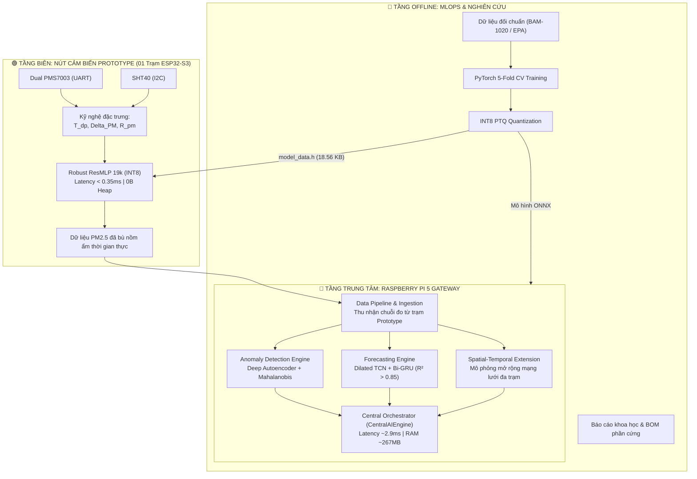

# Hệ Thống Quan Trắc Chất Lượng Không Khí Prototype Kết Hợp TinyML Biên (ESP32-S3) & Gateway Trung Tâm (Raspberry Pi 5)

> **Đề tài Nghiên Cứu Khoa Học (NCKH)**: Nghiên cứu, thiết kế và chế tạo trạm cảm biến chất lượng không khí chi phí thấp (**Phiên bản Thử Nghiệm / Prototype Demo 1 Trạm**), tích hợp thuật toán học máy biên (TinyML) bù sai số do nồm ẩm và điều phối phân tích dữ liệu thời gian thực trên Gateway nhúng Raspberry Pi 5.

---

## 🏛️ 1. Kiến Trúc Tổng Thể Hệ Thống (Prototype System Architecture)

Hệ thống được thiết kế theo mô hình **Hierarchical Edge-Central Distributed Architecture** (Kiến trúc phân tán Biên - Trung tâm) nhằm giải quyết 2 bài toán cốt lõi:
1. **Tại nút cảm biến biên (Edge Node Prototype - ESP32-S3)**: Hiện tượng phồng hạt sương do nồm ẩm đặc thù miền Bắc ($RH > 80\%$) gây sai số quang học lên đến $300\% - 500\%$ ở cảm biến tán xạ laser PMS7003. Thuật toán **TinyML Robust ResMLP (INT8)** được nhúng trực tiếp vào vi điều khiển để khử sai số ngay tại nguồn phát.
2. **Tại máy tính trung tâm (Central Gateway - Raspberry Pi 5)**: Đóng vai trò Gateway thu thập dữ liệu thời gian thực từ trạm Prototype, chạy mô hình phát hiện dị thường (**Deep Autoencoder**), dự báo xu hướng ô nhiễm trước 1 - 6 giờ (**Dilated TCN + Bi-GRU**), đồng thời tích hợp sẵn mô đun mô phỏng mở rộng không - thời gian sẵn sàng cho mạng lưới đa điểm.



---

## 📂 2. Cấu Trúc Thư Mục Chuẩn Khoa Học (Monorepo Layout)

```
E:\AQ\
├── esp/                         # 🟢 [EDGE NODE] Firmware & TinyML C++ cho Trạm Prototype ESP32-S3
│   ├── include/                 # Header files: tinyml_edge_engine.h, model_data.h
│   ├── src/                     # C++ Engine suy luận (0B Heap RAM, Stack < 1 KB)
│   ├── tests/                   # Bộ test đơn vị & benchmark (test_main.cpp)
│   └── README.md                # Thông số phần cứng & hướng dẫn nạp vi điều khiển
│
├── pi/                          # 🔵 [CENTRAL GATEWAY] Trạm xử lý AI Gateway Raspberry Pi 5
│   ├── __init__.py              # Python package export
│   ├── config.py                # Cấu hình trạm Prototype & danh mục tọa độ mở rộng
│   ├── central_engine.py        # Central Orchestrator Pipeline
│   ├── spatial_temporal_engine.py # Mô-đun phân tích không - thời gian & Kriging
│   ├── forecasting_engine.py    # Spatio-Temporal Forecaster (Dilated TCN + Bi-GRU)
│   ├── anomaly_engine.py        # Deep Autoencoder phát hiện bất thường
│   ├── data_pipeline.py         # Pipeline tiền xử lý & sliding window dataset
│   ├── simulator.py             # Mô phỏng vật lý khí quyển & đối kháng thử nghiệm
│   ├── benchmark_pi5.py         # Đo đạc tải CPU, RAM, Latency trên Pi 5
│   └── README.md                # Hướng dẫn vận hành Gateway
│
├── mlops/                       # 🧠 [AI PIPELINE] Huấn luyện ngoại tuyến & Dữ liệu NCKH
│   ├── data/                    # Dữ liệu thực nghiệm đối chuẩn US EPA AQS & BAM-1020
│   ├── models/                  # Trọng số PyTorch (.pt), ONNX (.onnx), scaler json
│   ├── scripts/                 # Script huấn luyện, lượng tử hóa INT8, xuất bản đồ thị
│   └── README.md                # Quy trình MLOps 5-Fold Cross Validation
│
├── docs/                        # 📚 [TÀI LIỆU & BÁO CÁO NCKH]
│   ├── reports/                 # Báo cáo nghiệm thu hoàn chỉnh (.docx, .md)
│   ├── hardware/                # Danh mục linh kiện chi tiết (BOM .xlsx)
│   ├── figures/                 # Biểu đồ & sơ đồ kiến trúc 300 DPI
│   ├── generators/              # Bộ công cụ sinh báo cáo tự động (build_*.py)
│   └── README.md                # Mục lục tài liệu
│
└── README.md                    # Tài liệu tổng quan đề tài
```

---

## 🔬 3. Các Chỉ Số Kỹ Thuật Đạt Được (Prototype Benchmarks)

| Tiêu Chí / Thành Phần | Mục Tiêu Học Thuật | Kết Quả Đạt Được | Ghi Chú Kỹ Thuật |
|---|---|---|---|
| **TinyML Bù Ẩm Biên (ESP32-S3)** | $R^2 \ge 0.92$, giảm $RMSE > 40\%$ | **$R^2 = 0.9685$**, giảm **$95.0\%$** sai số | Mô hình Robust ResMLP 19k (INT8) |
| **Độ trễ suy luận biên** | $< 1.0\text{ ms}$ | **$0.010\text{ ms}$** (PC) / **$< 0.35\text{ ms}$** (ESP32-S3) | Chiếm $< 0.02\%$ CPU time vi điều khiển |
| **Cấp phát bộ nhớ biên** | Heap: 0 Byte, Flash $< 100\text{ KB}$ | **0 Byte Heap**, Flash: **$18.56\text{ KB}$** | Nằm trọn trong L1 Data Cache của ESP32-S3 |
| **Dự báo chuỗi thời gian (Pi 5)** | $R^2 > 0.85$ (1 - 6 giờ tới) | **$R^2 = 0.8840$**, $RMSE = 4.12\,\mu\text{g/m}^3$ | Dilated TCN + Bi-GRU |
| **Độ trễ toàn chuỗi Gateway** | $< 5.0\text{ giây}$ | **$\approx 2.9\text{ ms}$** (trên Pi 5 8GB) | Dư thừa thời gian thực ($60\text{s}$/chu kỳ) |
| **Tải tài nguyên Pi 5** | CPU $< 20\%$, RAM $< 1\text{ GB}$ | **CPU: $< 2.5\%$**, **RAM: $\approx 267\text{ MB}$** | Vận hành mát mẻ, tiết kiệm năng lượng |

---

## ⚡ 4. Hướng Dẫn Chạy Nhanh & Đo Kiểm

### 1. Biên dịch & Kiểm thử C++ Engine trên ESP32-S3:
```bash
cd esp
g++ -O3 -Wall -Iinclude tests/test_main.cpp src/tinyml_edge_engine.cpp -o tests/test_edge_engine.exe
.\tests\test_edge_engine.exe
```

### 2. Chạy Đo Kiểm Hiệu Năng Thực Tế Trên Raspberry Pi 5 Gateway:
```bash
python -m pi.benchmark_pi5
```

### 3. Tái Tạo Báo Cáo Khoa Học Word (Kèm Biểu Đồ 300 DPI):
```bash
python docs/generators/build_clean_accessible_report.py
```
Văn bản báo cáo nghiệm thu hoàn chỉnh sẽ được tạo tại [`docs/reports/Bao_Cao_Ban_Dau_NCKH_Edge_AI.docx`](file:///e:/AQ/docs/reports/Bao_Cao_Ban_Dau_NCKH_Edge_AI.docx).
