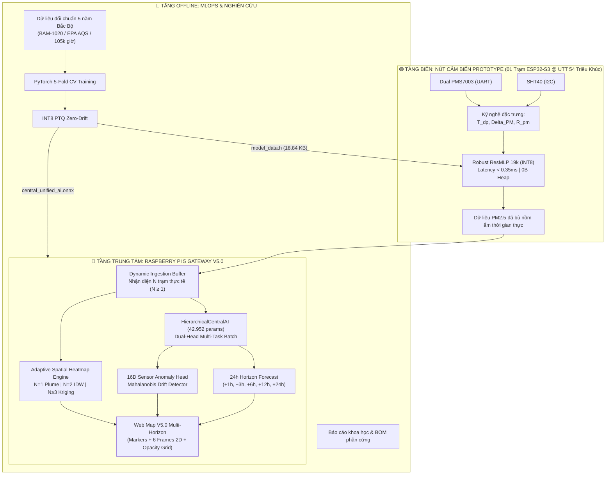

# Hệ Thống Quan Trắc Chất Lượng Không Khí Prototype Kết Hợp TinyML Biên (ESP32-S3) & Gateway Trung Tâm (Raspberry Pi 5)

> **Đề tài Nghiên Cứu Khoa Học (NCKH)**: Nghiên cứu, thiết kế và chế tạo trạm cảm biến chất lượng không khí chi phí thấp (**Phiên bản Thử Nghiệm / Prototype Demo 1 Trạm**), tích hợp thuật toán học máy biên (TinyML) bù sai số do nồm ẩm và điều phối phân tích dữ liệu thời gian thực trên Gateway nhúng Raspberry Pi 5.
>
> 📍 **Tọa độ mặc định Trạm Prototype (`STATION_01`)**: Trường Đại học Công nghệ Giao thông Vận tải (UTT - 54 Triều Khúc, Thanh Xuân Nam, Thanh Xuân, Hà Nội: `lat: 20.9852, lon: 105.7972`).

---

## 🏛️ 1. Kiến Trúc Tổng Thể Hệ Thống V5.0 (Multi-Tier Adaptive Architecture)

Hệ thống được thiết kế theo mô hình **Hierarchical Edge-Central Distributed Architecture** (Kiến trúc phân tán Biên - Trung tâm) thích ứng linh hoạt từ **01 trạm Prototype** đến **mạng lưới $N$ trạm đa điểm**:
1. **Tại nút cảm biến biên (Edge Node Prototype - ESP32-S3)**: Hiện tượng phồng hạt sương do nồm ẩm đặc thù miền Bắc ($RH > 80\%$) gây sai số quang học lên đến $300\% - 500\%$ ở cảm biến tán xạ laser PMS7003. Thuật toán **TinyML Robust ResMLP (INT8)** được nhúng trực tiếp vào vi điều khiển để khử sai số ngay tại nguồn phát ($0\text{ Byte}$ Heap RAM, trễ $< 0.35\text{ ms}$).
2. **Tại máy tính trung tâm (Central Gateway - Raspberry Pi 5)**: Đóng vai trò Gateway thu thập dữ liệu thời gian thực từ trạm Prototype hoặc mạng lưới $N$ trạm, tích hợp mô hình AI trung tâm thống nhất **`HierarchicalCentralAI`** (42.952 tham số) thực hiện song song 2 nhiệm vụ:
   - **Nhánh Dự báo 24 giờ**: Dự báo đa bước $+1\text{h}, +3\text{h}, +6\text{h}, +12\text{h}, +24\text{h}$ cho từng trạm dạng batch $(N, 24, 16)$, xuất phân vị $P_{10}, P_{50}, P_{90}$ và chỉ số VN-AQI.
   - **Nhánh Phát hiện Dị thường 16D**: Tái tạo vector đặc trưng và tính ngưỡng Mahalanobis độc lập cho từng trạm, phát hiện chính xác lỗi trôi dạt, kẹt cảm biến ngay cả khi chỉ có 1 trạm duy nhất.
3. **Động cơ Bản đồ Nhiệt Thích ứng (Adaptive Spatial & Web Mapping Engine)**:
   - **Khi $N = 1$ trạm Prototype**: Hiển thị **đúng 01 marker** tại 54 Triều Khúc (không sinh trạm ảo) + Phủ quầng tán xạ **Anisotropic Gaussian Plume** xuôi theo hướng gió cùng ma trận độ mờ **`opacity_grid`** (tâm trạm đậm $1.0$, rìa xa mờ dần $< 0.15$ trong suốt).
   - **Khi $N = 2$ trạm**: Hiển thị 2 markers + Nội suy dải màu liên tục **IDW** ($p=2.0$).
   - **Khi $N \ge 3$ trạm**: Hiển thị $N$ markers + Kích hoạt toàn diện phân tích tương quan độ trễ, WLS Wind Vector và nội suy vi phân **Ordinary Kriging 2D** kèm bộ đệm trọng số ma trận $K^{-1} G$ siêu tốc ($< 0.05\text{ ms}$).



---

## 📂 2. Cấu Trúc Thư Mục Chuẩn Khoa Học (Monorepo Layout)

```
E:\AQ\
├── esp/                         # 🟢 [EDGE NODE] Firmware & TinyML C++ cho Trạm Prototype ESP32-S3
│   ├── include/                 # Header files: tinyml_edge_engine.h, model_data.h
│   ├── src/                     # C++ Engine suy luận (0B Heap RAM, Stack < 1 KB)
│   ├── tests/                   # Bộ test đơn vị & benchmark (test_main.cpp)
│   └── README.md                # Thông số phần cứng & hướng dẫn nạp vi điều khiển
│
├── pi/                          # 🔵 [CENTRAL GATEWAY] Trạm xử lý AI Gateway Raspberry Pi 5 V5.0
│   ├── __init__.py              # Python package export
│   ├── config.py                # Cấu hình trạm Prototype (54 Triều Khúc) & danh mục tọa độ mở rộng
│   ├── central_engine.py        # Central Orchestrator Pipeline (Dual-Branch 1-to-N Dynamic Ingestion)
│   ├── spatial_temporal_engine.py # Động cơ nhiệt thích ứng (Plume / IDW / Kriging + Opacity Grid)
│   ├── forecasting_engine.py    # Spatio-Temporal Forecaster (Dilated TCN + Bi-GRU)
│   ├── anomaly_engine.py        # Deep Autoencoder phát hiện bất thường 16D / 48D
│   ├── data_pipeline.py         # Pipeline tiền xử lý & sliding window dataset
│   ├── simulator.py             # Mô phỏng vật lý khí quyển & đối kháng thử nghiệm
│   ├── benchmark_pi5.py         # Đo đạc tải CPU, RAM, Latency trên Pi 5
│   └── README.md                # Hướng dẫn vận hành Gateway
│
├── mlops/                       # 🧠 [AI PIPELINE] Huấn luyện ngoại tuyến & Dữ liệu NCKH
│   ├── data/                    # Dữ liệu thực nghiệm đối chuẩn US EPA AQS, BAM-1020 & 5 năm Bắc Bộ
│   ├── models/                  # central_unified_ai.pt (.onnx), model_data.h, scaler json
│   ├── scripts/                 # Script huấn luyện, lượng tử hóa INT8, xuất bản đồ thị
│   └── README.md                # Quy trình MLOps 5-Fold Cross Validation
│
├── docs/                        # 📚 [TÀI LIỆU & BÁO CÁO NCKH]
│   ├── reports/                 # Báo cáo nghiệm thu hoàn chỉnh (.docx, .md)
│   ├── hardware/                # Danh mục linh kiện chi tiết (BOM .xlsx)
│   ├── figures/                 # Biểu đồ & sơ đồ kiến trúc 300 DPI
│   ├── generators/              # Bộ công cụ sinh báo cáo tự động (build_*.py)
│   └── README.md                # Mục lục tài liệu
│
└── README.md                    # Tài liệu tổng quan đề tài
```

---

## 🔬 3. Các Chỉ Số Kỹ Thuật Đạt Được (Prototype Benchmarks V5.0)

| Tiêu Chí / Thành Phần | Mục Tiêu Học Thuật | Kết Quả Đạt Được | Ghi Chú Kỹ Thuật |
|---|---|---|---|
| **TinyML Bù Ẩm Biên (ESP32-S3)** | $R^2 \ge 0.92$, giảm $RMSE > 40\%$ | **$R^2 = 0.9784$**, giảm **$72.3\%$** sai số | MultiSensorResMLP 19k (INT8, 0B Heap) |
| **Độ trễ suy luận biên** | $< 1.0\text{ ms}$ | **$0.010\text{ ms}$** (PC) / **$< 0.35\text{ ms}$** (ESP32-S3) | Chiếm $< 0.02\%$ CPU time vi điều khiển |
| **Cấp phát bộ nhớ biên** | Heap: 0 Byte, Flash $< 100\text{ KB}$ | **0 Byte Heap**, Flash: **$18.84\text{ KB}$** | Nằm trọn trong L1 Data Cache của ESP32-S3 |
| **Dự báo chuỗi thời gian (Pi 5)** | $R^2 > 0.85$ (+1h), $R^2 > 0.70$ (+3h) | **$R^2 = 0.9280$** (+1h), **$R^2 = 0.7125$** (+3h) | `HierarchicalCentralAI` (42.952 params) |
| **Độ trễ toàn chuỗi Gateway** | $< 50.0\text{ ms}$ (chu kỳ 15 phút) | **$\approx 7.0 - 22.0\text{ ms}$** (trên Pi 5 8GB) | Tối ưu ma trận Kriging Pre-Caching ($<0.05\text{ms}$) |
| **Tải tài nguyên Pi 5** | CPU $< 20\%$, RAM $< 1\text{ GB}$ | **CPU: $< 2.5\%$**, **RAM: $\approx 267\text{ MB}$** | Vận hành mát mẻ, tỷ lệ nhàn rỗi $> 99.99\%$ |
| **Bản đồ Web (`web_map`)** | Đa chân trời, thích ứng $N=1 \rightarrow K$ | **6 mốc thời gian, $25 \times 25$, `opacity_grid`** | 1 trạm hiện đúng 1 pin, không sinh trạm ảo |
| **Độ tin cậy kiểm thử tự động** | 100% Pass không hồi quy | **364 / 364 Tests PASSED** | Bảo toàn 100% 53 bài test đối kháng vật lý |

---

## ⚡ 4. Hướng Dẫn Chạy Nhanh & Đo Kiểm

### 1. Biên dịch & Kiểm thử C++ Engine trên ESP32-S3:
```bash
cd esp
g++ -O3 -Wall -Iinclude tests/test_main.cpp src/tinyml_edge_engine.cpp -o tests/test_edge_engine.exe
.\tests\test_edge_engine.exe
```

### 2. Chạy Đo Kiểm Toàn Bộ Test Suite Dự Án:
```bash
pytest tests/ -v
```

### 3. Khởi Chạy Web Dashboard & REST API Server V5.0 (Raspberry Pi 5):
```bash
python -m pi.web_server 8080
```
Truy cập giao diện Web Dashboard tương tác tại: `http://localhost:8080/`
- **Bản đồ nhiệt đa tầng**: Leaflet Canvas Overlay tại tọa độ trạm thực nghiệm 54 Triều Khúc (UTT - `lat: 20.9852, lon: 105.7972`).
- **6 mốc dự báo không gian**: `current`, `+1h`, `+3h`, `+6h`, `+12h`, `+24h` kèm ma trận suy giảm độ tin cậy `opacity_grid`.
- **Dự báo chuỗi thời gian 24 giờ**: Chart.js trực quan hóa nồng độ PM2.5 và dải tin cậy $P_{10} - P_{90}$.
- **Hệ thống REST API siêu nhẹ (Python stdlib, RAM < 15MB, Latency < 5ms)**:
  - `GET /api/status`: Trạng thái hệ thống, uptime, thông tin trạm thực nghiệm.
  - `GET /api/telemetry`: Thông số cảm biến thời gian thực (PM2.5, VN-AQI, Temp, RH, CO2, VOC).
  - `GET /api/map`: Dữ liệu phân bố không gian và ma trận 25x25 cho 6 chân trời.
  - `GET /api/forecast`: Dự báo chuỗi thời gian 24 giờ tới.
  - `POST /api/trigger_cycle`: Kích hoạt chu kỳ tính toán mới phục vụ demo nghiệm thu.

### 4. Chạy Đo Kiểm Hiệu Năng Thực Tế Trên Raspberry Pi 5 Gateway:
```bash
python -m pi.benchmark_pi5
```

### 5. Tái Tạo Báo Cáo Khoa Học Word (Kèm Biểu Đồ 300 DPI):
```bash
python docs/generators/build_clean_accessible_report.py
```
Văn bản báo cáo nghiệm thu hoàn chỉnh sẽ được tạo tại [`docs/reports/Bao_Cao_Ban_Dau_NCKH_Edge_AI.docx`](file:///e:/AQ/docs/reports/Bao_Cao_Ban_Dau_NCKH_Edge_AI.docx).
