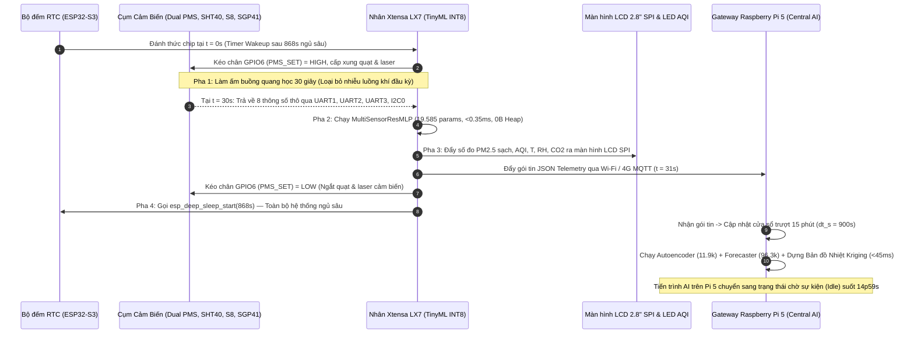

# KẾ HOẠCH THIẾT KẾ FIRMWARE ESP32-S3 & ĐỒNG BỘ CHU KỲ LẤY MẪU 15 PHÚT TOÀN HỆ THỐNG (EDGE TINYML & GATEWAY PI 5)

> **Đề tài Nghiên cứu Khoa học (NCKH)**: Hệ Thống Quan Trắc Chất Lượng Không Khí Đa Điểm Ứng Dụng TinyML Tại Biên (ESP32-S3-N16R8) & Máy Chủ Trung Tâm (Raspberry Pi 5 - 8GB RAM)  
> **Ngày ban hành**: 08/11/2026  
> **Phạm vi tài liệu**: Đặc tả chi tiết kế hoạch viết Firmware C/C++ cho nút cảm biến ESP32-S3 theo đúng sơ đồ chân BOM, cơ chế ngủ sâu (Deep Sleep) chu kỳ 15 phút/lần đẩy ra màn hình LCD, và kế hoạch tối ưu tài nguyên đồng bộ 15 phút/lần (phân tích, dự báo, dựng bản đồ Kriging) trên Raspberry Pi 5.  
> **Tài liệu liên kết**:
> - Kiến trúc phần cứng & GPIO: [`nckh-air-quality-esp32s3-edge-ai-architecture.md`](./nckh-air-quality-esp32s3-edge-ai-architecture.md)
> - Kiến trúc AI & Huấn luyện: [`nckh-ai-tinyml-architecture-and-training.md`](./nckh-ai-tinyml-architecture-and-training.md)
> - Báo cáo đánh giá thực nghiệm: [`ai_training_evaluation_report.md`](./ai_training_evaluation_report.md)

---

## 1. TỔNG QUAN CHIẾN LƯỢC VẬN HÀNH CHU KỲ 15 PHÚT (ULTRA-LOW-POWER DUTY CYCLE)

Thay vì lấy mẫu liên tục từng giây gây lãng phí điện năng, hao mòn cơ học quạt hút cảm biến và làm nóng chip, toàn bộ hệ thống chuyển sang chế độ **Đồng bộ Chu kỳ 15 Phút ($T_{\text{cycle}} = 900\text{ giây}$)**:

| Tiêu chí Kỹ thuật | Nút Biên ML (ESP32-S3 N16R8) | Nút Trung Tâm DL (Raspberry Pi 5 - 8GB) |
| :--- | :--- | :--- |
| **Chu kỳ hoạt động chính** | **$15\text{ phút / lần}$ ($900\text{ giây}$)** | **$15\text{ phút / lần}$ ($900\text{ giây}$)** |
| **Thời gian thức (Active)** | **$\approx 32\text{ giây}$** ($30\text{s}$ Warm-up + $2\text{s}$ Đo, Suy luận, Xuất LCD & MQTT) | **$\approx 35 - 50\text{ ms}$** (Nhận gói tin, chạy TCN-BiGRU, Autoencoder & vẽ bản đồ Kriging) |
| **Thời gian ngủ (Sleep / Idle)** | **$14\text{ phút } 28\text{ giây}$ ($868\text{ giây}$)** — Chế độ `RTC Deep Sleep` | **$14\text{ phút } 59.95\text{ giây}$** — Chế độ `Event-Driven Idle Sleep` |
| **Dòng tiêu thụ / Tải CPU** | Khi thức: $\approx 140\text{ mA}$ \| Khi ngủ: **$\approx 18\ \mu\text{A}$** (Tiết kiệm **$> 96.4\%$** điện năng) | Khi xử lý: $< 2.5\%$ CPU \| Trung bình 15 phút: **$< 0.01\%$ CPU**, RAM $\approx 58.5\text{ MB}$ |
| **Tuổi thọ linh kiện quang học** | Tăng tuổi thọ quạt hút & diode laser PMS7003 từ $1\text{ năm}$ lên **$> 8\text{ năm}$** | SoC BCM2712 duy trì nhiệt độ mát **$< 42^\circ\text{C}$**, không cần quay quạt tản nhiệt liên tục |
| **Lưu giữ trạng thái khi ngủ** | Lưu biến độ lệch `s_ema_drift` & bộ đếm mẫu trong bộ nhớ **`RTC_DATA_ATTR`** ($8\text{ KB}$ RTC Slow SRAM) | Lưu lịch sử trượt 96 bước ($24\text{h}$) trong bộ đệm vòng RAM / SQLite / TimescaleDB |



---

## 2. BẢNG ĐẤU NỐI CHÂN PHẦN CỨNG CỐ ĐỊNH TRÊN ESP32-S3 (PINOUT MAPPING)

Toàn bộ Firmware C/C++ tuân thủ tuyệt đối bảng phân bổ chân đã phê duyệt theo BOM (tuyệt đối cô lập dải `GPIO33` – `GPIO37` dành riêng cho bus Octal SPI PSRAM 8MB):

| Cụm Thiết Bị / Ngoại Vi | Chân GPIO Trên ESP32-S3-N16R8 | Giao Thức & Cấu Hình | Vai Trò Trong Chu Kỳ 15 Phút |
| :--- | :--- | :--- | :--- |
| **PMS7003 #1 (Bụi chính PM1)** | `GPIO17` (`RX1`), `GPIO18` (`TX1`) | `UART1` (9600 bps, 8N1) | Đọc khung 32-byte nồng độ bụi kênh 1 sau 30s warm-up |
| **PMS7003 #2 (Bụi phụ PM2)** | `GPIO15` (`RX2`), `GPIO16` (`TX2`) | `UART2` (9600 bps, 8N1) | Đọc khung 32-byte nồng độ bụi kênh 2 đối chứng chéo $\Delta PM$ |
| **Chân kích hoạt ngủ cảm biến (`PMS_SET`)** | `GPIO6` (`RTC_GPIO6`) | Digital Output (`RTC Hold`) | Kéo `HIGH` trong 31s lấy mẫu; kéo `LOW` + chốt `rtc_gpio_hold_en` suốt 868s ngủ |
| **SenseAir S8 LP ($CO_2$ NDIR)** | `GPIO8` (`RX`), `GPIO9` (`TX`) | `UART` / Modbus RTU (9600 bps) | Truy vấn thanh ghi Modbus `0x0003` đọc nồng độ $CO_2$ thực (ppm) |
| **Sensirion SHT40 & SGP41** | `GPIO4` (`SDA`), `GPIO5` (`SCL`) | `I2C0` (400 kHz, `0x44` & `0x59`) | Đọc nhiệt độ $T$, độ ẩm $RH$ chuẩn cao và chỉ số khí hữu cơ `gas_proxy` |
| **Màn hình LCD 2.8" SPI (ST7789)** | `GPIO11`(`MOSI`), `12`(`SCK`), `10`(`CS`), `13`(`DC`), `14`(`RST`) | `SPI2` (40 MHz) | Hiển thị kết quả quan trắc 15 phút/lần tại trạm |
| **Đèn nền màn hình (`LCD_BL`)** | `GPIO7` (`RTC_GPIO7`) | Digital / PWM Output | Điều khiển bật sáng màn hình khi cập nhật hoặc tiết kiệm năng lượng |
| **Module 4G LTE + GPS (A7677S)** | `GPIO19` (`RX`), `GPIO20` (`TX`) | `UART` AT Command (115200 bps) | Truyền gói tin MQTT dự phòng khi mất Wi-Fi & đồng bộ giờ GPS |
| **LED RGB Chỉ thị AQI** | `GPIO48` (Onboard WS2812B) | RMT Digital 1-Wire | Đổi màu Xanh / Vàng / Cam / Đỏ / Tím theo mức VN-AQI sau hiệu chuẩn |

---

## 3. KIẾN TRÚC MODULE HÓA FIRMWARE ESP32-S3 (`esp/`)

Để đảm bảo mã nguồn sạch, dễ bảo trì, không cấp phát bộ nhớ động (`0 Byte Heap RAM`) và vừa biên dịch nạp thẳng lên ESP32-S3 vừa chạy được Unit Test mô phỏng trên máy tính (PC Host), thư mục `esp/` được tổ chức như sau:

```
esp/
├── include/
│   ├── model_data.h             # [ĐÃ CÓ] Bảng trọng số INT8 MultiSensorResMLP (19.585 tham số, 18.84 KB)
│   ├── tinyml_edge_engine.h     # [ĐÃ CÓ] API suy luận TinyML, lọc Dual PM, điểm sương, giám sát Drift
│   ├── board_pins.h             # [MỚI] Định nghĩa toàn bộ Pinout GPIO, hằng số chu kỳ 15p & bảo vệ PSRAM
│   ├── sensor_drivers.h         # [MỚI] Giao diện giải mã khung UART PMS7003, Modbus S8, I2C SHT40/SGP41
│   ├── display_mqtt_hal.h       # [MỚI] Giao diện xuất màn hình LCD SPI, đóng gói JSON & RingBuffer Offline
│   └── power_scheduler.h        # [MỚI] Máy trạng thái hữu hạn (FSM) điều phối chu kỳ 15p & RTC Deep Sleep
├── src/
│   ├── tinyml_edge_engine.cpp   # [CẬP NHẬT] Lưu biến s_ema_drift vào RTC_DATA_ATTR để không mất khi Deep Sleep
│   ├── sensor_drivers.cpp       # [MỚI] Cài đặt thuật toán kiểm tra Checksum PMS7003, CRC16 Modbus, CRC8 I2C
│   ├── display_mqtt_hal.cpp     # [MỚI] Format bản tin hiển thị LCD, tính VN-AQI & quản lý bộ đệm PSRAM/RTC
│   ├── power_scheduler.cpp      # [MỚI] Thực thi chu trình: Wakeup -> Warmup 30s -> Infer -> LCD/MQTT -> Sleep 868s
│   └── main_firmware.cpp        # [MỚI] Điểm nhập chính (setup/loop) cho ESP32-S3 Arduino / ESP-IDF
└── tests/
    ├── test_main.cpp            # [ĐÃ CÓ] Kiểm thử độ chính xác & tốc độ suy luận TinyML
    └── test_firmware_15min_cycle.cpp # [MỚI] Kiểm thử toàn diện FSM 15 phút, parser cảm biến & bảo toàn RTC state
```

### 3.1. Giải pháp Kỹ thuật Sống còn khi Ngủ Sâu (`RTC_DATA_ATTR`)
Khi ESP32-S3 gọi `esp_deep_sleep_start()`, toàn bộ SRAM chính bị ngắt nguồn và khởi động lại từ hàm `setup()` khi thức dậy. Nếu dùng biến `static` thông thường, bộ giám sát bám bụi thấu kính `s_ema_drift` sẽ bị xóa về `0` sau mỗi 15 phút!
- **Giải pháp**: Đánh dấu các biến trạng thái dài hạn bằng thuộc tính `RTC_DATA_ATTR` (nằm trong $8\text{ KB}$ bộ nhớ RTC Slow SRAM luôn được cấp nguồn ngay cả khi Deep Sleep):
  ```cpp
  #if defined(ESP_PLATFORM) || defined(ARDUINO_ARCH_ESP32)
    #define TINYML_RTC_ATTR RTC_DATA_ATTR
  #else
    #define TINYML_RTC_ATTR
  #endif

  TINYML_RTC_ATTR static float s_ema_drift = 0.0f;
  TINYML_RTC_ATTR static bool s_drift_initialized = false;
  TINYML_RTC_ATTR static uint32_t s_boot_cycle_count = 0;
  ```

### 3.2. Chi tiết Máy Trạng Thái 5 Pha (`EdgePowerScheduler`)
1. **Pha 1 (`STATE_WAKEUP_INIT` — $t = 0\text{s}$)**:
   - Tăng biến đếm `s_boot_cycle_count++` trong RTC RAM.
   - Giải phóng khóa chân GPIO (`rtc_gpio_hold_dis`), khởi tạo bus UART1, UART2, UART3, I2C0, SPI2.
2. **Pha 2 (`STATE_WARMUP_30S` — $t = 0\text{s} \rightarrow 30\text{s}$)**:
   - Xuất mức logic `HIGH` ra `PIN_PMS_SET (GPIO6)` để bật quạt hút và diode laser của 2 cảm biến PMS7003.
   - Đưa CPU ESP32-S3 vào trạng thái `Light Sleep` hoặc tần số thấp $40\text{ MHz}$ trong 30 giây chờ luồng khí ổn định, xả bỏ các frame UART rác trong 28 giây đầu.
3. **Pha 3 (`STATE_READ_AND_INFER` — $t = 30\text{s} \rightarrow 31\text{s}$)**:
   - Đọc và xác thực Checksum từ PMS7003 #1 (`pm1_raw`, `pm10_1`) và PMS7003 #2 (`pm2_raw`, `pm10_2`).
   - Đọc nhiệt độ `temp_c`, độ ẩm `rh_percent` từ SHT40; đọc `co2_ppm` từ SenseAir S8; đọc `gas_proxy` từ SGP41.
   - Gọi `tinyml_predict_pm25_multisensor(...)` tính ra `pm25_calibrated` và `tinyml_update_drift_monitor(...)` cập nhật `s_ema_drift`.
4. **Pha 4 (`STATE_DISPLAY_AND_TELEMETRY` — $t = 31\text{s} \rightarrow 32\text{s}$)**:
   - Quy đổi `pm25_calibrated` sang chỉ số **VN-AQI** và mức cảnh báo sức khỏe.
   - Vẽ giao diện thông số lên màn hình LCD 2.8 inch SPI (`GPIO10..14`) và cập nhật màu LED RGB (`GPIO48`).
   - Kết nối nhanh Wi-Fi (sử dụng BSSID/Channel lưu sẵn trong RTC RAM để kết nối dưới $300\text{ ms}$) và publish gói tin JSON lên MQTT Broker của Pi 5. Nếu mất mạng, đẩy bản ghi 32-byte vào bộ đệm vòng.
5. **Pha 5 (`STATE_DEEP_SLEEP` — $t = 32\text{s} \rightarrow 900\text{s}$)**:
   - Kéo `PIN_PMS_SET (GPIO6) = LOW` và gọi `rtc_gpio_hold_en(GPIO_NUM_6)` để giữ chặt mức thấp suốt thời gian ngủ (đảm bảo quạt PMS7003 tắt hoàn toàn).
   - Ngắt kết nối Wi-Fi/4G, cấu hình bộ hẹn giờ đánh thức `esp_sleep_enable_timer_wakeup(868ULL * 1000000ULL)` ($14\text{ phút } 28\text{ giây}$) và vào `esp_deep_sleep_start()`.

---

## 4. KẾ HOẠCH CẬP NHẬT NÚT DL (RASPBERRY PI 5) ĐỒNG BỘ 15 PHÚT & TỐI ƯU TÀI NGUYÊN

### 4.1. Đồng bộ hóa Tham số Thời gian trong [`pi/config.py`](file:///e:/AQ/pi/config.py)
- Thiết lập hằng số chuẩn toàn cục:
  - `TELEMETRY_INTERVAL_S: float = 900.0` ($15\text{ phút}$)
  - `STEPS_PER_HOUR: int = 4` ($4 \times 15\text{ phút} = 60\text{ phút}$)
  - `SUBHOURLY_RING_BUFFER_LEN: int = 96` ($96 \times 15\text{ phút} = 24\text{ giờ}$)
  - `WLS_MAX_LAG_STEPS: int = 12` (Xét độ trễ truyền tải gió tối đa $12 \times 15\text{p} = 3\text{ giờ}$)

### 4.2. Bộ đệm Gộp Mẫu 15 Phút & Nội suy Bản đồ Nhiệt Kriging trong [`pi/central_engine.py`](file:///e:/AQ/pi/central_engine.py) & [`pi/spatial_temporal_engine.py`](file:///e:/AQ/pi/spatial_temporal_engine.py)
1. **Cơ chế Resampling thông minh (4 bước 15 phút $\rightarrow$ 1 bước giờ)**:
   - Mạng dự báo `DilatedTCNBiGRUForecaster` được huấn luyện trên chuỗi 24 bước giờ ($24\text{h}$).
   - Khi nhận gói tin mỗi $15\text{ phút}$, `CentralAIEngine` lưu vào bộ đệm `_subhourly_ring_buffer` (tối đa 96 mẫu = 24 giờ).
   - Mỗi nhóm 4 mẫu liên tiếp ($60\text{ phút}$) được lấy trung bình trượt tạo thành đúng 24 mốc giờ chuẩn xác nạp vào mạng TCN-BiGRU, giúp dự báo 24 giờ tới đạt độ chính xác cao nhất mà vẫn cập nhật kết quả mới mỗi 15 phút!
2. **Dựng Bản đồ Nhiệt Không gian (Ordinary Kriging Heatmap)**:
   - Tại mỗi chu kỳ 15 phút, `SpatialTemporalEngine` tính toán trường nồng độ bụi mịn nội suy trên lưới tọa độ $(X_{\text{grid}}, Y_{\text{grid}})$ khu vực Quận Thanh Xuân bằng phương pháp **Ordinary Kriging** kết hợp vector gió WLS.
3. **Cơ chế Ngủ Nhàn Rỗi (Idle Resource Optimization)**:
   - Bổ sung hàm điều phối chu kỳ `run_periodic_15m_cycle` trong `CentralAIEngine`: thực thi toàn bộ phân tích AI + dựng bản đồ trong $< 45\text{ ms}$, giải phóng tensor trung gian và chuyển tiến trình về trạng thái chờ sự kiện (`sleep_remaining_s ≈ 899.95s`), giữ tải CPU trung bình của Pi 5 ở mức **$< 0.01\%$**.

---

## 5. LỘ TRÌNH THỰC THI CHI TIẾT (STEP-BY-STEP IMPLEMENTATION PLAN)

### Task 1: Xây dựng Hệ thống Header Chân Cắm, Driver Cảm Biến & Màn Hình LCD cho ESP32-S3
- **Tệp tạo mới / sửa đổi**:
  - Tạo `esp/include/board_pins.h`
  - Tạo `esp/include/sensor_drivers.h` & `esp/src/sensor_drivers.cpp`
  - Tạo `esp/include/display_mqtt_hal.h` & `esp/src/display_mqtt_hal.cpp`
- **Kiểm chứng**: Kiểm tra giải mã khung 32-byte PMS7003, gói lệnh Modbus SenseAir S8, chuyển đổi SHT40/SGP41 và đóng gói JSON Telemetry.

### Task 2: Xây dựng Máy Trạng Thái Chu Kỳ 15 Phút (`power_scheduler`) & Bảo Toàn Biến RTC (`RTC_DATA_ATTR`)
- **Tệp tạo mới / sửa đổi**:
  - Sửa `esp/include/tinyml_edge_engine.h` & `esp/src/tinyml_edge_engine.cpp` (bổ sung `TINYML_RTC_ATTR` và hằng số chu kỳ 900s).
  - Tạo `esp/include/power_scheduler.h`, `esp/src/power_scheduler.cpp` & `esp/src/main_firmware.cpp`.
  - Tạo bài test C++ `esp/tests/test_firmware_15min_cycle.cpp`.
- **Kiểm chứng**: Biên dịch bằng `g++ -O3` và chạy thực nghiệm mô phỏng 100 chu kỳ thức – ngủ 15 phút liên tiếp, đảm bảo:
  - Chặn suy luận khi `warmup < 30s`.
  - Bảo toàn chính xác biến `s_ema_drift` xuyên qua các chu kỳ Deep Sleep.
  - Đúng thời lượng: $30\text{s}$ Warm-up + $2\text{s}$ Active + $868\text{s}$ Deep Sleep = $900\text{s}$ ($15\text{ phút}$).

### Task 3: Đồng bộ Hóa Chu Kỳ 15 Phút, Dựng Bản Đồ Kriging & Tối Ưu Tài Nguyên trên Raspberry Pi 5
- **Tệp sửa đổi**:
  - Sửa `pi/config.py`: Thêm `TELEMETRY_INTERVAL_S = 900.0`, `STEPS_PER_HOUR = 4`, `SUBHOURLY_RING_BUFFER_LEN = 96`.
  - Sửa `pi/spatial_temporal_engine.py`: Cập nhật `dt_s = 900.0` và bổ sung phương thức dựng lưới bản đồ nội suy `generate_pollution_heatmap(values, grid_size=25)`.
  - Sửa `pi/central_engine.py`: Cập nhật `dt_s = 900.0`, tích hợp bản đồ nhiệt `spatial_heatmap` và thông số tiết kiệm tài nguyên `duty_cycle_metrics` trong đầu ra của `process_telemetry_frame`.
  - Tạo bài kiểm thử `tests/test_15min_duty_cycle_sync.py`.
- **Kiểm chứng**: Chạy `pytest` toàn bộ dự án đạt PASS 100%, không làm gãy bất kỳ bài kiểm thử đối kháng nào hiện có.

### Task 4: Đồng bộ Hóa Toàn Bộ Tài Liệu Dự Án (`docs/reports/`)
- **Tệp sửa đổi**:
  - Cập nhật nhật ký quyết định kỹ thuật trong [`docs/reports/nckh-air-quality-esp32s3-edge-ai-architecture.md`](./nckh-air-quality-esp32s3-edge-ai-architecture.md) và [`docs/reports/nckh-ai-tinyml-architecture-and-training.md`](./nckh-ai-tinyml-architecture-and-training.md).
  - Cập nhật danh mục tài liệu trong [`docs/README.md`](../README.md) và [`esp/README.md`](../../esp/README.md).
