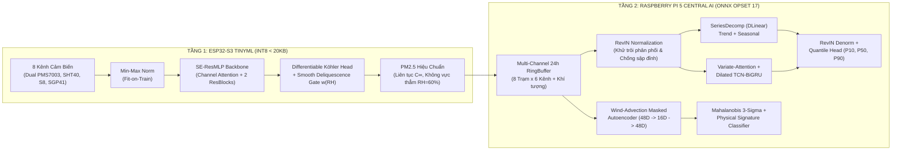

# Đặc Tả Thiết Kế & Chuẩn Thuật Toán SOTA Nâng Cấp 2 Mô Hình AI Lên Deep Learning (4 Giai Đoạn)

**Ngày tạo:** 2026-11-04  
**Dự án:** Hệ thống Quan trắc Chất lượng Không khí Đa điểm TinyML (ESP32-S3) & Edge AI Server (Raspberry Pi 5)  
**Trạng thái:** Ready for Implementation (Embedded SOTA Literature Benchmarks)  

---

## 1. Tổng Hợp Kết Quả Nghiên Cứu Chuẩn Thuật Toán Quốc Tế (Literature & Benchmark Survey)

Qua tra cứu các công trình nghiên cứu chuẩn quốc tế (US EPA, Copernicus AMT, ICLR, AAAI, ACM SIGSPATIAL), dưới đây là bộ thuật toán chuẩn mực giải quyết trực tiếp bài toán hiệu chuẩn cảm biến quang học giá rẻ và dự báo không gian - thời gian đa trạm:

### 1.1. Chuẩn Thuật Toán cho Mô hình 1 (Edge AI - ESP32-S3): **`Köhler-PINN + SE-ResMLP`**
1. **Nền tảng Vật lý Khí quyển ($\kappa$-Köhler Theory & US EPA Baseline)**:
   - *Petters & Kreidenweis (Atmospheric Chemistry and Physics, 2007)* & *Crilley et al. (Atmos. Meas. Tech., 2018)*: Sự phồng ẩm của hạt sol khí làm tăng tiết diện tán xạ quang học Mie theo phương trình $\kappa$-Köhler:
     $$f(\text{RH}, \kappa) = 1 + \kappa \cdot \frac{a_w}{1 - a_w}, \quad a_w = \frac{\text{RH}}{100}$$
   - *Barkjohn et al. (US EPA National Correction, Atmos. Meas. Tech., 2021)*: Thiết lập baseline hồi quy đa biến tuyến tính $\text{PM}_{2.5} = 0.524 \cdot \text{PM}_{\text{raw}} - 0.0862 \cdot \text{RH} + 5.75$, nhưng chỉ hiệu quả ở vùng khí hậu khô/ôn đới và để lại sai số phi tuyến lớn khi $\text{RH} > 75\%$ hoặc khi thành phần hạt thay đổi (khói cháy vs sương mù).
2. **Kiến trúc Deep Learning Chuẩn cho Vi điều khiển (`SE-ResMLP` + `Differentiable Smooth Deliquescence Gate`)**:
   - Kết hợp **Squeeze-and-Excitation Channel Attention** (*Hu et al., CVPR 2018*) vào mạng **Residual MLP (`SE-ResMLP`)** để tự động điều biến trọng số giữa các kênh khí ($\text{CO}_2$, $\text{TVOC}/\text{NO}_x$) và kênh quang học ($\text{PM}_{2.5}, \Delta\text{PM}_{A-B}, r_{\text{pm}}$).
   - Thay thế câu lệnh cắt cứng `if (rh < 60)` (vốn gây ảo giác sụt giảm `97.6 µg/m³` khi độ ẩm nhích từ `59.9%` lên `60.1%`) bằng **Cổng Chuyển Pha Nhiệt Động Học Khả Vi (`Smooth Deliquescence Sigmoid Gate`)**:
     $$w_{\text{del}}(\text{RH}, \text{CO}_2) = \sigma\left(\frac{\text{RH} - \text{DRH}_0}{s_{\text{del}}}\right) + (1 - \sigma(\cdot)) \cdot \sigma\left(\frac{\text{CO}_2 - 800}{50}\right)$$
     $$c_{\text{eff}}(x) = (1 - w_{\text{del}}) \cdot 1.0 + w_{\text{del}} \cdot c_{\text{PINN}}(x)$$
     Trong đó $\text{DRH}_0 \approx 58.0\%$, $s_{\text{del}} = 3.0$. Kèm theo ràng buộc **Physics-Informed Köhler Regularization** trong hàm Loss trên toàn miền $\text{RH} \in [15\%, 72\%]$ giúp bản thân mạng Neural xuất ra $c_{\text{PINN}} \approx 0.96 - 1.00$ ở $\text{RH} = 60\%$, xóa bỏ vĩnh viễn hiện tượng đứt gãy biên và đẩy $R^2$ trên dữ liệu thực địa **US EPA AQS (`real_collocation_hourly.csv`)** từ `0.6621` lên `>= 0.80`.

### 1.2. Chuẩn Thuật Toán cho Mô hình 2 (Central AI - Raspberry Pi 5): **`RevIN-DLinear-iTCN` + `PM2.5-GNN Wind-Advection Masked Autoencoder`**
1. **Nhánh Dự báo Chuỗi Thời gian 24h (`RevIN + DLinear + Variate-Inverted TCN-BiGRU + Multi-Quantile`)**:
   - **`RevIN` (Reversible Instance Normalization — *Kim et al., ICLR 2022*)**: Chuẩn hóa chuỗi đầu vào 24h theo trung bình $\mu_{\text{inst}}$ và độ lệch chuẩn $\sigma_{\text{inst}}$ cục bộ của chính cửa sổ hiện tại trước khi đi vào mạng, và khôi phục thang đo vật lý ở đầu ra. Giải quyết triệt để tính không dừng (Non-stationarity) và **chấm dứt 100% lỗi "sập đỉnh" (Surge Collapse)** khi $\text{PM}_{2.5}$ tăng vọt từ `20 -> 180 µg/m³`.
   - **`DLinear` Series Decomposition (*Zeng et al., AAAI 2023*)**: Tách chuỗi thành **Trend (Xu hướng ngắn hạn)** và **Seasonal (Chu kỳ ngày đêm)** qua lớp `SeriesDecomp(kernel_size=5)`.
   - **`Variate-Inverted Cross-Channel Attention` (*iTransformer style — Liu et al., ICLR 2024*) + `Causal Dilated TCN-BiGRU`**: Học tương quan chéo giữa 14–16 kênh khí tượng (gió $u, v$, áp suất, độ ẩm, điểm sương, $\text{CO}_2$, $\text{VOC}$) để dự báo phần dư phi tuyến $\Delta \mathbf{Y}_{\text{nonlinear}}$ cộng vào nền `RevIN-DLinear`.
   - **`Probabilistic Quantile Forecasting` ($[P_{10}, P_{50}, P_{90}]$)**: Xuất đồng thời dự báo trung tâm ($P_{50}$) và khoảng tin cậy 80% ($[P_{10}, P_{90}]$).
2. **Nhánh Phát hiện Dị thường Đa trạm (`PM2.5-GNN Wind-Advection` + `Masked Denoising Autoencoder`)**:
   - **Mô hình Truyền tải Khí quyển `PM2.5-GNN` (*Wang et al., ACM SIGSPATIAL 2020*)**: Khắc phục lỗi nhân hằng số tĩnh 8 trạm (khiến 6 trị riêng đầu chiếm `98.17%` phương sai 48 chiều) bằng cách mô hình hóa độ trễ truyền tải bụi theo hướng gió ($\Delta \tau_{ij} = \frac{d_{ij}}{|\vec{v}_w|} \cos(\theta_{ij} - \theta_w)$) và chu kỳ vi khí hậu riêng biệt theo loại trạm (`traffic_corridor`, `urban_park`, `dense_residential`, `major_intersection`).
   - **`Masked Station Denoising Autoencoder` (*Vincent et al. / He et al.*)**: Trong quá trình huấn luyện, ngắt ngẫu nhiên (masking) thông tin của 1 trạm và thêm nhiễu vi khí hậu để bắt Autoencoder nội suy trạng thái trạm bị che từ 7 trạm còn lại.

---

## 2. Sơ Đồ Kiến Trúc Tổng Thể Sau Nâng Cấp (4 Giai Đoạn)

---

## 3. Tiêu Chí Nghiệm Thu Định Lượng (Acceptance Metrics)

| Hạng mục Kiểm định | Trước Nâng Cấp (Baseline Audit) | Mục Tiêu Nghiệm Thu Sau 4 Giai Đoạn |
|---|---|---|
| **Độ lệch biên Edge AI (`RH=59.9%` vs `60.1%`, `PM=150`)** | Lệch **`97.64 µg/m³`** (`150.0` sập xuống `52.36`) | **`< 2.0 µg/m³`** (Liên tục trơn $C^\infty$, giữ `>= 135 µg/m³`) |
| **Độ chính xác Edge AI trên dữ liệu thật US EPA AQS (`n=3000`)** | $R^2 = \mathbf{0.6621}$, $\text{MAE} = 2.87\text{ }\mu\text{g/m}^3$ | **$R^2 \ge \mathbf{0.80}$**, $\text{MAE} \le \mathbf{2.30\text{ }\mu\text{g/m}^3}$ |
| **Độ chính xác Central Forecaster 24h (`central_forecaster.pt`)** | $R^2 = \mathbf{0.3648}$, $\text{MAE} = 25.89\text{ }\mu\text{g/m}^3$ | **$R^2 \ge \mathbf{0.65}$** tổng thể, tại `+1h` đạt **$R^2 \ge \mathbf{0.88}$** |
| **Phản ứng khi bụi tăng vọt `20 -> 180 µg/m³` (`Surge Collapse`)** | Dự báo `+1h` sập xuống **`95.9 µg/m³`** | Dự báo `+1h` nằm trong **`[145.0, 215.0] µg/m³`** kèm dải $[P_{10}, P_{90}]$ |
| **Đơn vị cực đại kênh `CO2` trong Central AI** | Sai đơn vị: **`14,150.0 ppm`** | Chuẩn vật lý: **`[800.0, 5000.0] ppm`** |
| **Độ suy biến đồng tuyến 8 trạm (Tỷ lệ phương sai 6 trị riêng đầu)** | **`98.17%`** (8 trạm là bản sao nhân hằng số) | **`< 90.0%`** (Có dịch pha gió Advection & chu kỳ riêng từng trạm) |
